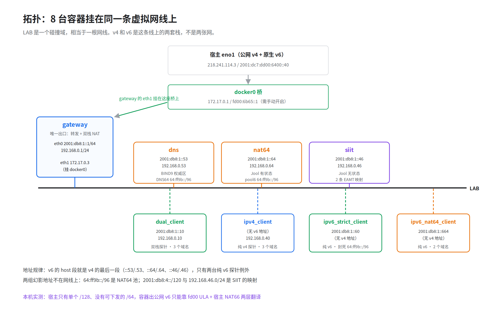
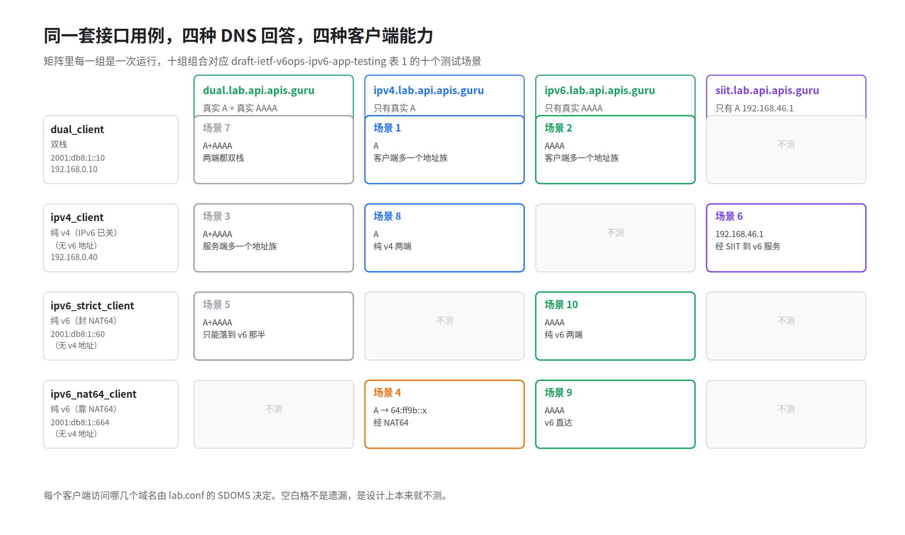
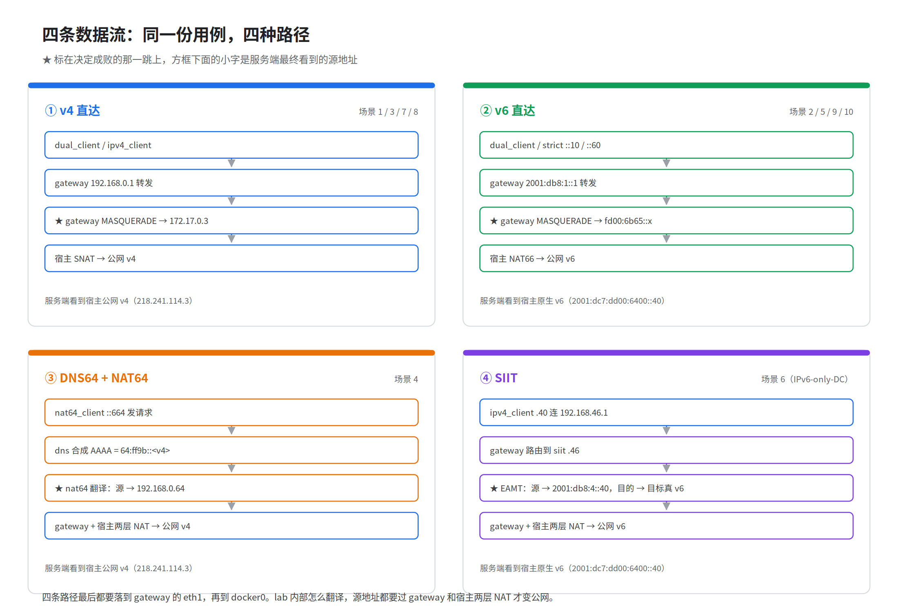

# V6Bench 调研报告

用一套接口用例，把「服务在纯 IPv6 环境下还能不能用」问清楚

版本 2026-11-03 ｜ 对应仓库 commit 628619f ｜ 实测机器 UOS 20 + Docker 19.03.8.2

---

## 0 一页纸结论

- V6Bench 是一台地址族实验台。被测服务放在一边不动，只换三样东西：客户端的地址族能力、DNS 的回答方式、中间有没有翻译设备。
- 它回答的问题只有一句：同一批 API，当客户端只有 IPv6、域名只解析出 IPv6、服务端自己只有 IPv6 时，HTTP 状态码会不会变。
- 一次运行覆盖十个测试场景，对应 draft-ietf-v6ops-ipv6-app-testing 表 1 的十个场景，产物是十行 CSV。
- 断言只有一条：HTTP 状态码等于 spec 里声明的成功码。不验业务正确性，不测性能。
- 拼装的都是现成组件：Jool 做翻译、BIND9 做 DNS 视图和 DNS64、Kathara 编排拓扑、ScanAPI 跑用例、Docker 做底座。

---

## 1 这个工具是干什么的，解决什么问题

### 1.1 单栈上线前真正要回答的问题

推进 IPv6 单栈，卡人的不是网络能不能通 v6，是业务能不能只靠 v6 活着。

这两件事差别很大。双栈服务器上，代码里写死的 IPv4 地址、日志和告警里配错的回调、第三方 SDK 里藏着的 IPv4 字面量，全都被 IPv4 那一半悄悄兜住。测试的时候一切正常，等客户端真的只剩 IPv6，问题才一个个冒出来，冒出来的方式各不相同：

- 域名只有 A 记录，客户端解析不到东西；
- 服务端监听在 0.0.0.0，v6 请求直接拒连；
- 依赖 DNS64 合成，但合成的地址回不来；
- 客户端按 RFC 6724 优先选了 IPv6，而那条 IPv6 路是黑洞，等超时而不是立刻失败。

这些问题有个共同点：在双栈环境里都能「看起来正常」。

### 1.2 现有手段为什么不够

手工 curl 是最常见的做法。它的毛病不是不准，是不可重复：一个人一个角度，换个时间换个网络，结论就对不上；出了问题靠抓包，抓完包结论又只留在那个人脑子里。

搭一套真环境成本更高：要一个纯 IPv6 客户端网络、一个 IPv6-only 服务端、一套 DNS64/NAT64，还得能随时切回去。真做一次，通常只做一次。

结果就是「单栈适配」在很多项目里变成了一次性验收动作，而不是可以反复跑的回归。

### 1.3 它测的是什么

一句话定义：V6Bench 在一台虚拟网络里准备四类客户端和四个 DNS 视图，对同一份 OpenAPI 用例跑十遍，比较十个测试场景下的 HTTP 状态码。

取舍很清楚：不动被测服务，只动网络条件。服务端不用改代码、不用重部署，甚至可以不归这边管。变的只有三样：客户端有没有 IPv4、域名解析出什么记录、中间有没有翻译设备。

### 1.4 明确不解决什么

- 不验业务正确性。响应体对不对，它不管。
- 不测性能。没有并发、没有压测、没有时延统计。
- 不覆盖安装、升级、界面这类生命周期场景（draft §3.6 到 §3.9 基本没碰）。
- 不管业务层的降级策略。它能指出哪一格是红的，给不出红了以后怎么办。

### 1.5 依赖的五个组件

| 组件 | 干什么 | 在这套环境里承担哪一段 | 参考 |
|---|---|---|---|
| Jool | Linux 内核的 NAT64 与 SIIT 实现，以 netfilter 挂载 | nat64 与 siit 两台设备各装一份，一台有状态翻译，一台无状态翻译 | [Jool 介绍](https://nicmx.github.io/Jool/en/intro-xlat.html) |
| BIND9 | 权威 DNS 服务 | 四个 DNS 视图在这里定义，DNS64 合成也在这里 | [BIND9 文档](https://bind9.readthedocs.io/) |
| Kathara | 容器化网络实验框架，读拓扑描述展开成容器 | 把八台设备和一个虚拟交换机搭成一条二层网线 | [Kathara 文档](https://www.kathara.org/) |
| ScanAPI | 读 OpenAPI 描述发 HTTP 请求，按断言出报告 | 十次运行全部由它执行，CSV 就是它的输出 | [ScanAPI 文档](https://scanapi.dev/) |
| Docker | 容器底座 | NAT64 与 SIIT 要装内核模块，容器需要特权并挂载宿主内核目录 | [Docker 文档](https://docs.docker.com/) |

---

## 2 架构：八台设备与一个虚拟交换机

### 2.1 架构图



拓扑不是「一个路由器隔出好几个网段」，是一个扁平的二层段：八台设备全挂在同一个 LAB 碰撞域上，IPv4 和 IPv6 是这条线上的两套栈，不是两张网。这一点理解对，后面每条路由才看得顺。

二层段由 kathara 自建的 VDE 软交换机提供。它不是容器，是一条虚拟总线，八台设备都插在它上面，所以图里设备之间没有路由器。

只有 gateway 有第二个接口 eth1，bridged 到宿主的 docker0；也只有它做转发和 NAT。其余七台设备的默认路由一律指向 gateway。

### 2.2 八台设备逐台说明

| 设备 | 镜像 | IPv4 | IPv6 | 跑哪些域名 |
|---|---|---|---|---|
| gateway | kathara/base | 192.168.0.1 | 2001:db8:1::1 | 不跑用例，只转发 |
| dns | kathara/bind | 192.168.0.53 | 2001:db8:1::53 | 不跑用例，只解析 |
| nat64 | kathara/base | 192.168.0.64 | 2001:db8:1::64 | 不跑用例，只翻译 |
| siit | kathara/base | 192.168.0.46 | 2001:db8:1::46 | 不跑用例，只翻译 |
| dual_client | kathara/base | 192.168.0.10 | 2001:db8:1::10 | dual / ipv4 / ipv6 |
| ipv4_client | kathara/base | 192.168.0.40 | 无 | dual / ipv4 / siit |
| ipv6_strict_client | kathara/base | 无 | 2001:db8:1::60 | dual / ipv6 |
| ipv6_nat64_client | kathara/base | 无 | 2001:db8:1::664 | ipv4 / ipv6 |

gateway 是唯一出口。它开内核转发，对 eth1 做双栈 MASQUERADE，并加三条静态路由：64:ff9b::/96 指向 nat64，2001:db8:4::/120 和 192.168.46.0/24 指向 siit。没有这三条，包在实验台里就走丢了。

dns 跑 BIND9，权威区是 lab.<域名>，按视图返回不同记录，同时开着 DNS64。客户端拿到什么地址，全由它决定。

nat64 跑 Jool 的 NAT64，配置一个 IPv6 前缀池 64:ff9b::/96。纯 v6 客户端发往这个前缀的包，由它翻成 IPv4 送出去，回包按会话表翻回来。

siit 跑 Jool 的 SIIT，维护一张地址映射表（EAMT）。EAMT 是 IPv4 前缀与 IPv6 前缀的一一对应关系，翻译只改地址，不建会话。这张表里有两条：一条把实验台的 v4 网段映射到 v6 网段，管源地址；一条把一个假 v4 地址映射到被测服务的真 v6 地址，管目的地址。

dual_client 双栈，两条路都有，测的是「双栈客户端看各种形态的服务端」。

ipv4_client 纯 v4，连 IPv6 栈都没开，测的是「纯 v4 客户端看双栈服务、纯 v4 服务，以及被翻译出来的 v6 服务」。

ipv6_strict_client 纯 v6，且主动封掉 NAT64 前缀，模拟不装翻译也得活的客户端。

ipv6_nat64_client 纯 v6，靠 DNS64 加 NAT64 访问 v4 世界，是过渡技术兜底的代表。

### 2.3 地址怎么配

地址在拓扑描述里按设备声明，每台各写一条 IPv4 和一条 IPv6。规律好记：v6 的 host 段取 v4 的最后一段，.53 对 ::53，.64 对 ::64，.46 对 ::46。只有两台纯 v6 探针例外，是 ::60 和 ::664。

每台客户端跑哪些场景也在拓扑描述里声明，写明一组域名后缀。ipv4_client 声明 dual、ipv4、siit 三个，strict 客户端只声明 dual 和 ipv6。strict 不跑 ipv4 那格是设计上的不应该，不是漏配：它连 NAT64 都封了，跑了也必然失败。

nat64 与 siit 要装内核模块，容器需要特权模式，并把宿主的内核源码目录和模块目录挂进去。这也是起整套环境需要 root 的原因。

启动顺序也声明在拓扑里：gateway 先起，dns 跟上，然后是 nat64、siit 和各客户端。ipv4_client 特意排在 siit 之后，ipv6_nat64_client 排在 nat64 之后，等翻译设备就位再跑用例。

---

## 3 原理与数据流：同一域名，四种网络环境

### 3.1 核心机关：DNS 视图

BIND9 的视图（view）功能允许同一个区按来源返回不同记录。V6Bench 把这一点用足：四个视图，四个不同的答案，客户端无感知。

| 视图 | 区内记录 | 等价于什么样的部署 |
|---|---|---|
| dual.lab.X | 真实 A + 真实 AAAA | 服务端双栈，两种协议都能到 |
| ipv4.lab.X | 只有真实 A | 服务端只有 IPv4 |
| ipv6.lab.X | 只有真实 AAAA | 服务端只有 IPv6 |
| siit.lab.X | 一条 A = 192.168.46.1 | 服务端在 IPv6-only 机房，靠翻译设备对外 |

生成的区文件长这样（真实目标的一份）：

```
siit	IN	A	192.168.46.1
dual	IN	A	60.29.240.41
dual	IN	AAAA	2408:8711:10:1001::3e
ipv4	IN	A	60.29.240.41
ipv6	IN	AAAA	2408:8711:10:1001::3e
```

host 名字不同，客户端查哪个名字就拿到哪种部署形态。第 1 行是关键设计：它不给客户端一个 v6 地址，而是给一条假 v4 地址，让 SIIT 那台设备把包翻成 v6 送出去，「IPv4 客户端访问 IPv6-only 服务」这条路由此成立。

BIND 同时开着 DNS64，前缀 64:ff9b::/96，合成本身按 RFC 6052，整体行为定义在 RFC 6147。查 ipv4.lab.X 的 AAAA 记录，拿到的是由 A 记录合成的地址，例如 60.29.240.41 合成出来是 64:ff9b::3c1d:f029。把这个值按 RFC 6052 反解，正好还原成那条 A 记录，合成逻辑可以直接对着验。

### 3.2 四类客户端与十个测试场景

四类客户端的能力不同，能跑的场景也不同。两两组合起来，正好是 draft 表 1 的十个场景。



| draft 场景 | 客户端 → 服务端 | 落在哪一组 |
|---|---|---|
| 1 | 双栈 → IPv4-only | dual_client × ipv4.lab |
| 2 | 双栈 → IPv6-only-strict | dual_client × ipv6.lab（客户端视角） |
| 3 | IPv4-only → 双栈 | ipv4_client × dual.lab |
| 4 | v6-only+NAT64 → IPv4-only | nat64_client × ipv4.lab |
| 5 | v6-only-strict → 双栈 | strict_client × dual.lab |
| 6 | IPv4-only → v6-only（IPv6-only 机房） | ipv4_client × siit.lab |
| 7 | 双栈 → 双栈 | dual_client × dual.lab |
| 8 | IPv4-only → IPv4-only | ipv4_client × ipv4.lab |
| 9 | v6-only+NAT64 → v6-only-strict | nat64_client × ipv6.lab |
| 10 | v6-only-strict → v6-only-strict | strict_client × ipv6.lab |

口径上有两处要打折扣：

- 场景 2 和 10 写的是服务端 IPv6-only-strict，控制的只是客户端看到什么记录。外部服务器自己有没有 IPv4，这套环境管不了。这两格是客户端视角的 strict。
- 场景 6 在 draft 里指 IPv6-only 机房，这里用 SIIT 实现，不是有状态 NAT64。方向对得上，机制不同。

### 3.3 四条路径逐跳



四条路径讲的是同一个请求在四种网络环境里的走法，差别只在地址怎么变、经过哪台设备。

v4 原生（ipv4_client 访问 ipv4.lab.X）。客户端查到真实 A 记录，发包目的地址就是那条 A。下一跳是 gateway，gateway 从 eth1 转出去，源地址在出口处被 NAT 成公网 v4。全程没有翻译设备参与。

v6 原生（ipv6_strict_client 访问 ipv6.lab.X）。客户端查到真实 AAAA，目的地址就是那条 AAAA。下一跳还是 gateway，从 eth1 出去，源地址经 NAT66 成为公网 v6 地址。这条路上没有 v4 参与，是纯 v6 链路的样子。

DNS64 加 NAT64（ipv6_nat64_client 访问 ipv4.lab.X）。这个客户端只有 v6 栈，查 A 记录没有意义，所以查 AAAA，拿到合成的 64:ff9b::x。包发往这个前缀，gateway 按静态路由交给 nat64，Jool 的 NAT64 把目的地址翻回那条真实 A，源地址翻成 nat64 自己的 v4 地址，再按 v4 路径出去。回包按会话表反向还原。这是「纯 v6 客户端访问纯 v4 服务」的标准过渡方案。

SIIT（ipv4_client 访问 siit.lab.X）。客户端只有 v4 栈，查到的 A 是那条假地址 192.168.46.1。包发往它，gateway 按静态路由交给 siit，Jool 的 SIIT 查 EAMT：目的地址 192.168.46.1 对应被测服务的真 v6 地址，源地址 192.168.0.x 对应实验台的 v6 网段 2001:db8:4::x。地址一换，包以纯 v6 形态继续往外走，回包再按同一张表换回来。翻译不建会话，没有状态过期的问题。

四条路径分工互补：DNS64 加 NAT64 解决 v6 客户端到 v4 服务，SIIT 解决 v4 客户端到 v6 服务，另外两条是不带翻译的对照组。

### 3.4 汇总

| 客户端 | 域名 | 走的路径 | 关键设备 |
|---|---|---|---|
| dual_client | dual.lab.X | v6 或 v4，按地址选择 | gateway |
| dual_client | ipv4.lab.X | v4 原生 | gateway |
| dual_client | ipv6.lab.X | v6 原生 | gateway |
| ipv4_client | dual.lab.X | v4 原生 | gateway |
| ipv4_client | ipv4.lab.X | v4 原生 | gateway |
| ipv4_client | siit.lab.X | SIIT 翻译 | siit |
| ipv6_strict_client | dual.lab.X | v6 原生 | gateway |
| ipv6_strict_client | ipv6.lab.X | v6 原生 | gateway |
| ipv6_nat64_client | ipv4.lab.X | DNS64 + NAT64 | dns, nat64 |
| ipv6_nat64_client | ipv6.lab.X | v6 原生 | gateway |

这十组组合在本机完整跑通过，十个场景都按预期出了结果。表格里的路径划分，就是逐条实测过的走法。

---

## 4 参考价值

### 4.1 这套模拟能让人看见什么

四类客户端加四个 DNS 视图，等于不用建四套机房，就把四种部署形态摆在同一条网线上。服务端一行代码没改，看到的却是「双栈服务端」「纯 v4 服务端」「纯 v6 服务端」「v6 机房加翻译设备」四种世界。造环境的这套思路，对验收单栈改造是可复用的。

一服务一矩阵是可以直接借用的口径。十个场景十行结果，比「ping 通了」「能打开」具体：哪一类客户端在哪一种服务端形态下掉了状态码，一张表看完。验收口径落在状态码上，就能进回归，而不是一次性验收。

翻译路径的分工看得清楚。DNS64 加 NAT64 管 v6 客户端到 v4 服务，SIIT 管 v4 客户端到 v6 服务，方向相反，机制也不同，一个有状态一个无状态。真要给业务配翻译设备，先想清楚缺的是哪条方向，比先选产品管用。

### 4.2 模拟不了什么

- 运营商网络的真实丢包、时延和 MTU 行为。这套环境里链路是虚拟的，丢包率为零。
- CDN 与中间设备的策略差异。域名解析、证书、SNI 这些由外部设备决定的行为，实验台只给得出客户端侧的表现。
- 生产流量的规模与分布。十个场景各跑一两个请求，验证的是可达性和状态码，不是容量。

---

## 附录 A 标准与参考链接

| 主题 | 出处 |
|---|---|
| NAT64 与 DNS64 的组合 | RFC 6146、RFC 6147 |
| IPv4 地址嵌入 IPv6 地址的编码 | RFC 6052 |
| SIIT 无状态翻译 | RFC 7915 |
| 单栈环境下的应用测试场景 | draft-ietf-v6ops-ipv6-app-testing（表 1 十个场景） |
| Jool 的翻译机制说明 | https://nicmx.github.io/Jool/en/intro-xlat.html |
| BIND9 视图与 DNS64 | https://bind9.readthedocs.io/ |
| Kathara 拓扑描述 | https://www.kathara.org/ |
| ScanAPI 用例格式 | https://scanapi.dev/ |

## 附录 B 复现环境

三步：按被测域名生成 DNS 区文件，把 OpenAPI 描述转换成用例文件，起拓扑。起拓扑需要 root，nat64 与 siit 要装内核模块。命令序列和产物说明在 doc/report/README.md。
