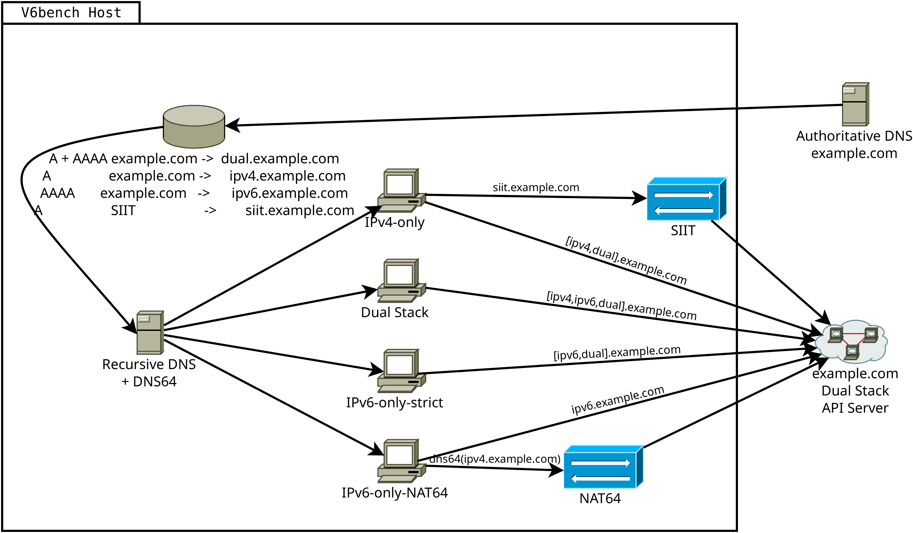
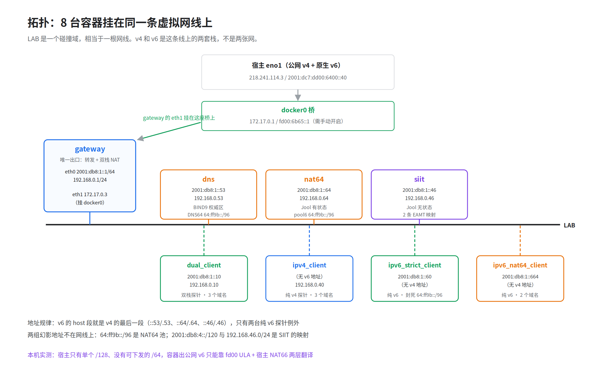
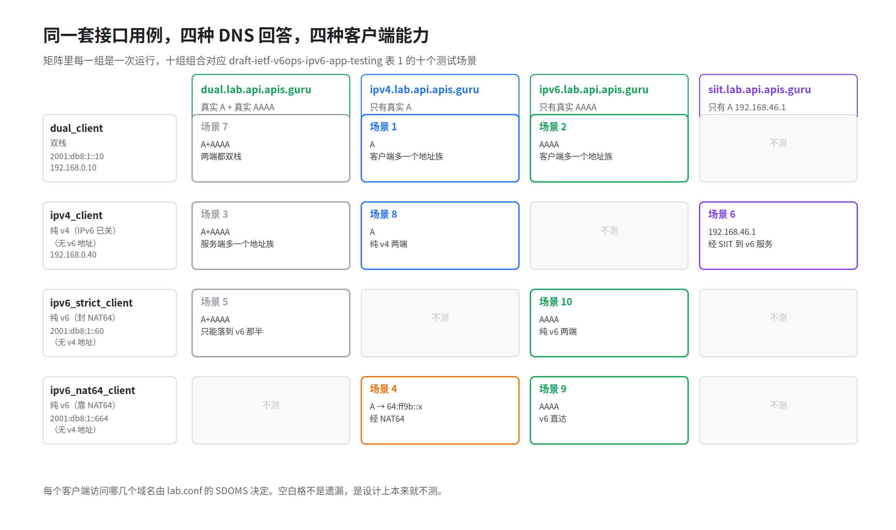
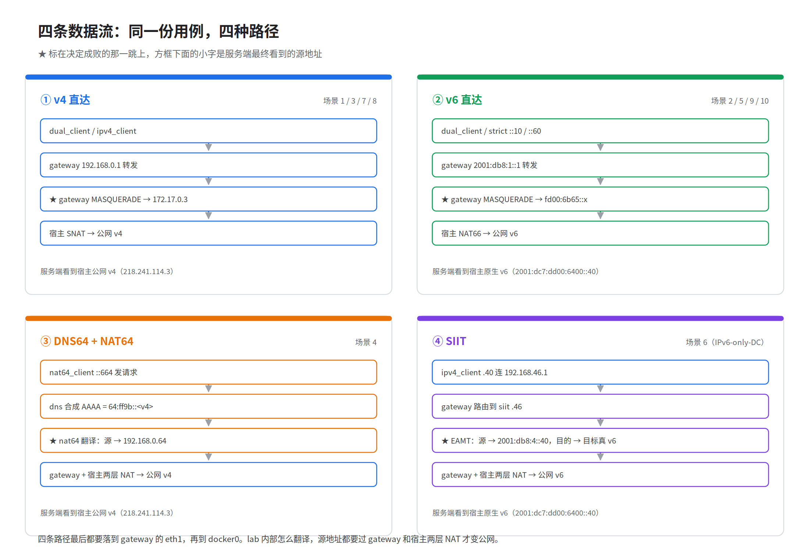

# V6Bench 调研报告

---

## 概述

V6Bench 是巴西 NIC.br（CEPTRO.br 团队）的 Sávyo de Morais 在 [RIPE 93](https://ripe93.ripe.net/programme/meeting-plan/sessions/)（2026 年 10 月 26 日，保加利亚索非亚，远程演示）上公开演示的开源 IPv6 应用就绪性测试工具，仓库在 [github.com/CEPTRO-br/v6bench](https://github.com/CEPTRO-br/v6bench)。

它要解决的核心痛点是：网络通了不等于应用可用。网络侧接通 IPv6 之后，应用侧往往还残留 IPv4 假设：域名只有 A 记录、服务端监听 0.0.0.0、代码和第三方 SDK 里藏着 IPv4 字面量、依赖 DNS64/NAT64 却回不来。这些在双栈环境里都被 IPv4 那一半掩盖，平时测不出来，到了纯 IPv6 环境才暴露，业务就无法正常使用。

---

## 1 这个工具是干什么的，解决什么问题

### 1.1 单栈上线前真正要回答的问题

推进 IPv6 单栈，难点不在网络能否通 v6，而在业务能否仅靠 v6 正常运行。

这两件事差别很大。双栈服务器上，代码里写死的 IPv4 地址、日志和告警里配错的回调、第三方 SDK 里藏着的 IPv4 字面量，都被 IPv4 那一半掩盖。测试阶段一切正常，等客户端真的只剩 IPv6，问题才陆续暴露，且暴露方式各不相同：

- 域名只有 A 记录，客户端解析不到东西；
- 服务端监听在 0.0.0.0，v6 请求直接连不上；
- 依赖 DNS64 合成，但合成的地址回不来；
- 客户端按 RFC 6724 优先选了 IPv6，而那条 IPv6 路是黑洞，等超时而不是立刻失败。

这些问题有个共同点：在双栈环境里都能「看起来正常」。

### 1.2 现有手段为什么不够

应用程序的 IPv6 测试「没有成文的最佳实践」，而网络设备和操作系统的 IPv6 合规测试「已被充分文档化」——应用侧是空白。

手工逐条请求加抓包，能定位单次故障，但 [draft](https://datatracker.ietf.org/doc/draft-ietf-v6ops-ipv6-app-testing/) 对网络抓包的评价是「最易出错」的方法：它要求测试者完全理解应用的流量走向，还要求能解读抓包输出（draft §4.5）。结论依赖具体的人，换人、换时间未必复现；多个场景要反复回归，人手撑不住。

搭真环境是另一条路，成本同样被 draft 点名：在某些环境里「为所有场景搭测试用例会贵得吓人」（draft §4），复杂云应用、平台型产品、企业 IT 尤甚。障碍还具体到系统层面：Android 和 iOS 不允许关闭 IPv4，测 IPv6-only-strict 只能整个环境纯 v6（draft §4.1）；桌面虚拟化、企业登录关掉 IPv4 后机器直接不可用（draft §4.1）。

这两条合起来的结果是：单栈适配容易变成一次性验收动作，而不是可反复执行的回归。draft 给出的方向也是把测试绑回功能与集成测试（draft §3），让场景验证成为可以反复执行的一部分。

### 1.3 它测的是什么

一句话定义：V6Bench 在一台虚拟网络里准备四类客户端和四个名字，对同一份 OpenAPI 用例在不同网络模拟环境中运行，比较不同测试场景下的 HTTP 状态码。

这套测试方法的关键是发起端和判定端都在客户端：请求从客户端发出，结论也在客户端取得——能否到达服务端、能否拿到预期的状态码。四种服务端形态是靠 DNS 返回不同记录伪装出来的，服务端全程被动应答，并不知道自己被模拟成了哪种形态。

原则：不动被测服务，只动网络条件。服务端不用改代码、不用重部署，甚至可以是别人维护的系统。变的只有三样：客户端有没有 IPv4、域名解析出什么记录、中间有没有翻译设备。

能发现的典型问题：

- 服务只监听 IPv4（bind 0.0.0.0，没有监听 ::）。解析到 v6 地址的请求全部失败；走 v4 或 NAT64 的请求照常。
- 域名只有 A 记录、没有 AAAA（或 AAAA 指向错的地址）。只靠 v6 地址的请求失败，双栈客户端因为还能用 A 仍然可工作。
- 服务按源地址做逻辑：白名单、限速、风控、会话粘滞、审计。源地址翻译后（nat64 客户端访问 ipv4 名字、纯 v4 客户端访问 siit 名字），会被拒或误判。
- 重定向或响应里给出的地址只对 v4 可达（Location、回调地址）。requests 会跟进 302，跟过去连不上。

### 1.4 明确不解决什么

- 不验业务正确性。响应体对不对，它不管。
- 不测性能。没有并发、没有压测、没有时延统计。
- 不覆盖安装、升级、界面这类生命周期场景（draft §3.6 到 §3.9 没碰）。
- 不管业务层的降级策略。它能指出哪一种组合是红的，给不出红了以后怎么办。

### 1.5 依赖的五个组件

| 组件 | 干什么 | 在这套环境里承担哪一段 | 参考 |
|---|---|---|---|
| Jool | Linux 内核的 NAT64 与 SIIT 实现，以 netfilter 方式运行 | nat64 与 siit 两台设备各装一份，一台有状态翻译，一台无状态翻译 | [Jool 关于 xlat 的介绍](https://nicmx.github.io/Jool/en/intro-xlat.html) |
| BIND9 | 权威 DNS 服务 | 四个名字的记录在这里定义，DNS64 合成也在这里 | [BIND9 文档](https://bind9.readthedocs.io/) |
| Kathara | 容器化网络实验框架，读拓扑描述展开成容器 | 把八台设备和一个虚拟交换机搭成一条二层网线 | [Kathara 文档](https://www.kathara.org/) |
| ScanAPI | 读 OpenAPI 描述发 HTTP 请求，按断言出报告 | 十次运行全部由它执行，CSV 就是它的输出 | [ScanAPI 文档](https://scanapi.dev/) |
| Docker | 容器底座 | NAT64 与 SIIT 要装内核模块，容器需要特权并挂载宿主内核目录 | [Docker 文档](https://docs.docker.com/) |

---

## 2 架构：八台设备与一个虚拟交换机

### 2.1 架构图



这张是设计时的概念图：四类客户端（IPv4-only、IPv6-only-strict、IPv6-only-NAT64、Dual Stack）、一套 DNS（含 DNS64）、NAT64 与 SIIT 两台翻译设备，共同对着同一个 API 服务端。图中 example.com 为示意域名，客户端标签沿用 draft 的场景名；落到实验台上，就是下面这套八台容器和真实地址。



拓扑不是「一个路由器隔出好几个网段」，是一个扁平的二层段：八台设备全挂在同一个 LAB 碰撞域上，IPv4 和 IPv6 是这条线上的两套栈，不是两张网。这一点理解清楚，后面的路由配置才讲得通。

二层段由 Kathara 自建的 VDE 软交换机提供。它不是容器，是一条虚拟总线，八台设备都插在它上面，所以图里设备之间没有路由器。

只有 gateway 有第二个接口 eth1，bridged 到宿主的 docker0；也只有它做转发和 NAT。其余七台设备的默认路由一律指向 gateway。

### 2.2 八台设备逐台说明

| 设备 | 镜像 | IPv4 | IPv6 | 访问哪些名字（均在 lab.api.apis.guru 下） |
|---|---|---|---|---|
| gateway | kathara/base | 192.168.0.1 | 2001:db8:1::1 | 不执行用例，只转发 |
| dns | kathara/bind | 192.168.0.53 | 2001:db8:1::53 | 不执行用例，只解析 |
| nat64 | kathara/base | 192.168.0.64 | 2001:db8:1::64 | 不执行用例，只翻译 |
| siit | kathara/base | 192.168.0.46 | 2001:db8:1::46 | 不执行用例，只翻译 |
| dual_client | kathara/base | 192.168.0.10 | 2001:db8:1::10 | dual / ipv4 / ipv6 |
| ipv4_client | kathara/base | 192.168.0.40 | 无 | dual / ipv4 / siit |
| ipv6_strict_client | kathara/base | 无 | 2001:db8:1::60 | dual / ipv6 |
| ipv6_nat64_client | kathara/base | 无 | 2001:db8:1::664 | ipv4 / ipv6 |

gateway 是唯一出口。它开内核转发，对 eth1 做双栈 MASQUERADE，并加三条静态路由：64:ff9b::/96 指向 nat64，2001:db8:4::/120 和 192.168.46.0/24 指向 siit。缺少这三条，数据包在实验台内就无法送达。
```bash
# Routing
sysctl -w net.ipv4.ip_forward=1
sysctl -w net.ipv6.conf.all.forwarding=1

# NAT64 route
ip -6 route add 64:ff9b::/96 via 2001:db8:1::64 dev eth0

# SIIT route
ip route add 192.168.46.0/24 via 192.168.0.46 dev eth0
ip -6 route add 2001:db8:4::/120 via 2001:db8:1::46 dev eth0

# NAT towards the bridged/external interface
iptables -t nat -A POSTROUTING -o eth1 -j MASQUERADE
ip6tables -t nat -A POSTROUTING -o eth1 -j MASQUERADE
```

dns 运行 BIND9，权威区是 `lab.<被测域名>`（本例 `lab.api.apis.guru`），被测域名变更时这里同步修改；四个名字各配一套记录，同时启用 DNS64。客户端能解析到什么地址，完全由这里决定。
named.conf.options 里实际只动了三处：关 DNSSEC 校验、监听 v6、开启 DNS64；区声明由 zonefile_creator.py 生成到 named.conf.lab-zones。两段原文见附录 B。

db.lab 内容如下（SOA/NS 头在前，四个名字的记录在后）：
```
$TTL 3600
@	IN	SOA	ns.lab.api.apis.guru.	hostmaster.lab.api.apis.guru. (
	2026110301
	3600
	900
	1209600
	300
)

@	IN	NS	ns.lab.
ns	IN	A	192.168.0.53
ns	IN	AAAA	2001:db8:1::53

siit	IN	A	192.168.46.1
dual	IN	A	172.66.157.227
dual	IN	A	104.20.45.57
dual	IN	AAAA	2606:4700:10::ac42:9de3
ipv4	IN	A	172.66.157.227
ipv4	IN	A	104.20.45.57
ipv6	IN	AAAA	2606:4700:10::ac42:9de3
```

nat64 运行 Jool 的 NAT64，配置一个 IPv6 前缀池 64:ff9b::/96。纯 v6 客户端发往这个前缀的包，由它转换成 IPv4 送出，回包按会话表反向还原（启动脚本见附录 B）。

siit 运行 Jool 的 SIIT，维护一张地址映射表（EAMT）。EAMT 是 IPv4 前缀与 IPv6 前缀的一一对应关系，翻译只改地址，不建会话。这张表里有两条：一条把实验台的 v4 网段映射到 v6 网段，负责源地址；一条把一个假 v4 地址映射到被测服务的真 v6 地址，负责目的地址，启动脚本与实际 EAMT 配置见附录 B。

dual_client 双栈，两条路都有，测的是「双栈客户端看各种形态的服务端」。

ipv4_client 纯 v4，连 IPv6 栈都没开，测的是「纯 v4 客户端访问双栈服务、纯 v4 服务，以及经翻译可达的 v6 服务」。

ipv6_strict_client 纯 v6，且主动封掉 NAT64 前缀，模拟不依赖任何翻译设备也能正常工作的客户端，关键配置见附录 B。

ipv6_nat64_client 纯 v6，靠 DNS64 加 NAT64 访问 v4 世界。

注：所有设备共用 shared.startup 添加地址，非 gateway 设备再将 gateway 设为默认路由出口，脚本见附录 B。

### 2.3 地址怎么配

地址在拓扑描述里按设备声明，每台各写一条 IPv4 和一条 IPv6。对应规律是：v6 的 host 段取 v4 地址的最后一段，.53 对 ::53，.64 对 ::64，.46 对 ::46。只有两台纯 v6 探针例外，是 ::60 和 ::664。

nat64 与 siit 要装内核模块，容器需要特权模式，并把宿主的内核源码目录和模块目录挂进去。每台客户端要执行哪些场景也在拓扑描述里声明，SDOMS 后面跟的就是它要访问的名字。入口脚本分两类：服务端四台共用 srv_entrypoint.sh，客户端四台共用 test_runner.sh；各设备自己的启动配置另写在 .startup 脚本里（见附录 B）。启动顺序单独声明，ipv4_client 排在 siit 之后，ipv6_nat64_client 排在 nat64 之后，待翻译设备就绪后再执行用例。

完整的 lab.conf（地址、特权、入口、SDOMS）与 lab.dep（启动顺序）见附录 B。

### 2.4 和真实网络怎么对应

真实网络按管理边界可以分成三段：终端客户网络（家庭或办公网内部，到光猫与路由器为止，用户自己管）、运营商网络（光猫出去到公网入口，运营商管）、服务所在网络（服务端机房及其所在网络，服务方管）。三段之间是真实的互联网路径，由不同主体各自运行。

实验台没有建三张网，而是把三段压到同一根 LAB 网线上，靠路由和 DNS 划分角色。逐段对应如下：

| 真实网络的一段 | 实验台里的对应 | 模拟到什么程度 |
|---|---|---|
| 终端客户网络 | 四台客户端容器和它们所在的 LAB 网段 | 全模拟。四类客户端就是这一段的四种状态，对应 draft §2.2 定义的四种基本连通场景：双栈是现状接入，纯 v4 是遗留接入，纯 v6 靠 NAT64 是移动网络这类由运营商提供翻译的接入，纯 v6-strict 是单栈终态 |
| 运营商网络 | gateway 约当光猫与路由器（两段的分界设备，自身在网线上）；宿主的 SNAT 与 NAT66 约当运营商出口；dns 的 DNS64 合成与 nat64 容器约当运营商部署的过渡设备 | 模拟配置：有没有 v4、装没装翻译设备、几层地址转换，都可切换。链路行为（丢包、时延、MTU）不模拟，见 4.2 |
| 服务所在网络 | 真实公网上的真实服务。实验台自己应答 lab 子域的 DNS（记录抄自真实域名；dig 查真实 DNS 无此子域），请求的 Host 头指回真实域名 | 服务实体不碰：真实路由、真实机房、真实 CDN。只伪装「部署形态」——DNS 四个名字加 siit |

两台翻译设备正好一段一台。nat64 配合 DNS64 属于运营商一段：客户端把包发往 64:ff9b::/96 这个运营商前缀，翻译发生在包离开终端网络的时刻，方向是 v6 客户端访问 v4 服务。siit 属于服务一段：客户端发往的 192.168.46.1 是 DNS 以服务端地址身份发布的假地址，翻译发生在包到达服务端一侧的时刻，方向是 v4 客户端访问 v6 服务，对应 draft 表 1 的 IPv6-only-DC 格，翻译装置因此落在服务侧（draft §3.1 的表述是这类机房用 NAT46 把 v6-only 服务暴露给 v4 互联网）。

这台 siit 容易被认成 464XLAT 的 CLAT，区别在地址归属。CLAT 在客户端设备里，把应用发往真实 v4 地址的包翻成 v6、映射到运营商前缀 64:ff9b::/96，前提是设备本身有 v6 连接，它不发布任何地址；siit 发布的 192.168.46.1 是 DNS 给 v6-only 服务的 v4 门面，映射目标是服务真实的 v6 地址。纯 v4 客户端没有 v6 栈，CLAT 无从落脚，这条通路只能由服务侧满足。draft §3.1 也明确不为 464XLAT 单设场景，理由是装了 CLAT 的设备从客户端视角与双栈无法区分。

这个对应关系里有一处与真实部署相反。v4 客户端访问 v6 服务这条路：真实世界里包先以 v4 横穿公网，到机房边缘才翻译成 v6；实验台为了把三段放在一根网线上，翻译发生在网线内侧，包先翻译成 v6、再以 v6 横穿公网。测「到不到得了」的结论一致，逐跳顺序相反。NAT64 方向两边顺序一致，都是先翻译、再进入对侧地址族的公网。

---

## 3 原理与数据流：同一域名，四种网络环境

### 3.1 核心机关：一个区，四个名字

BIND9 里就一个区 lab.api.apis.guru，里面放四个名字：dual、ipv4、ipv6、siit。每个名字后面配的记录不同，客户端查哪个名字就拿到哪套记录。这个做法有 draft 背书：§4.2 建议「给双栈服务端配一个只含 AAAA 记录的专用域名，就能模拟纯 v6 服务端」——ipv6 名字用的正是这条。

| 名字 | 区内记录 | 等价于什么样的部署 |
|---|---|---|
| dual.lab.api.apis.guru | 真实 A + 真实 AAAA | 服务端双栈，两种协议都能到 |
| ipv4.lab.api.apis.guru | 只有真实 A | 服务端只有 IPv4 |
| ipv6.lab.api.apis.guru | 只有真实 AAAA | 服务端只有 IPv6 |
| siit.lab.api.apis.guru | 一条 A = 192.168.46.1 | 服务端在 IPv6-only 机房，靠翻译设备对外 |

区文件中四个名字的记录如下（完整文件见 2.2，此处省去 SOA/NS 头）：

```
siit	IN	A	192.168.46.1
dual	IN	A	172.66.157.227
dual	IN	A	104.20.45.57
dual	IN	AAAA	2606:4700:10::ac42:9de3
ipv4	IN	A	172.66.157.227
ipv4	IN	A	104.20.45.57
ipv6	IN	AAAA	2606:4700:10::ac42:9de3
```

第 1 行（区文件中的 siit 记录）模拟的是 IPv4 客户端（还没升级到 v6 的老设备，或纯 v4 网络里的客户端）访问 IPv6 服务：它不给客户端 v6 地址，而是给一条假 v4 地址，由 SIIT 设备把包转换成 v6 送出，「IPv4 客户端访问 IPv6-only 服务」这条路径由此成立。手机上只支持 v4 的应用不属于这一格：设备带着 v6 连接，属于 464XLAT 的 CLAT 场景，该工具没有覆盖。

BIND 同时开着 DNS64，前缀 64:ff9b::/96，合成本身按 RFC 6052，整体行为定义在 RFC 6147。查 ipv4.lab.api.apis.guru 的 AAAA 记录，拿到的是由 A 记录合成的地址，例如 172.66.157.227 合成出来是 64:ff9b::ac42:9de3。把这个值按 RFC 6052 反解，正好还原成那条 A 记录，合成逻辑可直接据此验证。

### 3.2 四类客户端与十个测试场景

说明：四类客户端模拟网络能力各不相同；四个名字是伪装出来的，真实服务端无需任何改动，只是 DNS 给的答案不同。行是客户端网络，列是服务端形态，两两组合正好是 draft 表 1 的十个场景。



| draft 场景 | 客户端 → 服务端 | 落在哪一组 |
|---|---|---|
| 1 | 双栈 → IPv4-only | dual_client × ipv4.lab.api.apis.guru |
| 2 | 双栈 → IPv6-only-strict | dual_client × ipv6.lab.api.apis.guru（客户端视角） |
| 3 | IPv4-only → 双栈 | ipv4_client × dual.lab.api.apis.guru |
| 4 | v6-only+NAT64 → IPv4-only | nat64_client × ipv4.lab.api.apis.guru |
| 5 | v6-only-strict → 双栈 | strict_client × dual.lab.api.apis.guru |
| 6 | IPv4-only → v6-only（IPv6-only 机房） | ipv4_client × siit.lab.api.apis.guru |
| 7 | 双栈 → 双栈 | dual_client × dual.lab.api.apis.guru |
| 8 | IPv4-only → IPv4-only | ipv4_client × ipv4.lab.api.apis.guru |
| 9 | v6-only+NAT64 → v6-only-strict | nat64_client × ipv6.lab.api.apis.guru |
| 10 | v6-only-strict → v6-only-strict | strict_client × ipv6.lab.api.apis.guru |

补充说明：

- 场景 2 和 10 写的是服务端 IPv6-only-strict，控制的只是客户端看到什么记录。外部服务器自身是否具备 IPv4，超出这套环境的控制范围。这两格是客户端视角的 strict。
- 场景 6 在 draft 里指 IPv6-only 机房，draft 写作 NAT46，实验台用 SIIT 实现，方向一致。

### 3.3 四条路径逐跳



四条路径描述同一个请求在四种网络环境中的转发过程，差别在于地址如何变化、经过哪些设备。

v4 原生（ipv4_client 访问 ipv4.lab.api.apis.guru）。客户端查到真实 A 记录，发包目的地址就是那条 A。下一跳是 gateway，gateway 从 eth1 转出去，源地址先被 gateway MASQUERADE 成 172.17.0.3，再到宿主被 SNAT 成公网 v4，两层之后才出得去。全程没有翻译设备参与。

v6 原生（ipv6_strict_client 访问 ipv6.lab.api.apis.guru）。客户端查到真实 AAAA，目的地址就是那条 AAAA。下一跳还是 gateway，从 eth1 出去，源地址先被 gateway MASQUERADE 成 fd00:6b65::x，再经宿主 NAT66 变成公网 v6。这条路上没有 v4 参与，是纯 v6 链路的样子。

DNS64 加 NAT64（ipv6_nat64_client 访问 ipv4.lab.api.apis.guru）。该客户端只有 v6 栈，拿到 A 记录也无法使用，实际使用的是 DNS64 合成的 64:ff9b::ac42:9de3。包发往这个前缀，gateway 按静态路由交给 nat64，Jool 的 NAT64 把目的地址转换回那条真实 A，源地址转换成 nat64 自身的 v4 地址 192.168.0.64，再沿上文 v4 原生路径送出。回包按会话表反向还原。这是「纯 v6 客户端访问纯 v4 服务」的标准过渡方案。

SIIT（ipv4_client 访问 siit.lab.api.apis.guru）。客户端只有 v4 栈，查到的 A 是那条假地址 192.168.46.1。包发往它，gateway 按静态路由交给 siit，Jool 的 SIIT 查 EAMT：目的地址 192.168.46.1 对应被测服务的真 v6 地址，源地址 192.168.0.x 对应实验台的 v6 网段 2001:db8:4::x。地址转换完成后，包以纯 v6 形态回到 gateway。但 2001:db8:4::x 是文档前缀，公网不路由，还需经过 gateway 的 MASQUERADE 和宿主 NAT66 两层地址转换，变为公网 v6 后才能送出。回程沿这条链逐段还原：宿主 NAT66 还原、gateway 的 conntrack 还原、siit 查 EAMT 转换回 v4，最后以 v4 交回客户端。翻译本身不建会话，没有状态过期的问题，维持状态的是那两层 NAT 的 conntrack。

四条路径有一个共同点：服务端看到的源地址始终是宿主的公网地址，lab 内部地址均未暴露。

四条路径分工互补：DNS64 加 NAT64 解决 v6 客户端到 v4 服务，SIIT 解决 v4 客户端到 v6 服务，另外两条是不带翻译的对照组。

dual_client 访问 dual.lab.api.apis.guru 时两族记录都有，按 RFC 6724 排序 v6 先试、v4 兜底，前提是客户端有全球 v6 源地址；客户端只有 ULA 源地址时 label 不匹配，反过来 v4 先。

请求库没有 happy-eyeballs，v6 不可用时的表现是等连接超时后才轮到 v4，而不是立刻失败。

还有个连带影响：DNS64 对所有客户端生效，dual_client 查 ipv4.lab.api.apis.guru 也会拿到合成 AAAA，于是场景 1 的流量可能绕去 NAT64，测的就不是 v4 直连（有多种方案可强制走 v4，例如 DNS 分流：DNS 服务器列表中第一个放 **IPv4 映射 IPv6 地址 `::ffff:a.b.c.d`**，指向一台普通 IPv4 DNS）。

### 3.4 汇总

| 客户端 | 域名 | 走的路径 | 关键设备 |
|---|---|---|---|
| dual_client | dual.lab.api.apis.guru | v6 优先，v4 兜底（RFC 6724） | gateway |
| dual_client | ipv4.lab.api.apis.guru | v4 原生（合成 AAAA 会把它引去 NAT64） | gateway, nat64 |
| dual_client | ipv6.lab.api.apis.guru | v6 原生 | gateway |
| ipv4_client | dual.lab.api.apis.guru | v4 原生 | gateway |
| ipv4_client | ipv4.lab.api.apis.guru | v4 原生 | gateway |
| ipv4_client | siit.lab.api.apis.guru | SIIT 翻译 | siit |
| ipv6_strict_client | dual.lab.api.apis.guru | v6 原生 | gateway |
| ipv6_strict_client | ipv6.lab.api.apis.guru | v6 原生 | gateway |
| ipv6_nat64_client | ipv4.lab.api.apis.guru | DNS64 + NAT64 | dns, nat64 |
| ipv6_nat64_client | ipv6.lab.api.apis.guru | v6 原生 | gateway |

---

## 4 参考价值

### 4.1 可借鉴的五点

- 环境构造方法：客户端一侧用四台容器做出不同的地址族能力，服务端一侧不改任何代码，只让 DNS 对四个名字返回不同记录。客户端于是分别看到「双栈服务端」「纯 v4 服务端」「纯 v6 服务端」「v6 机房加翻译设备」四种形态。四种组合并存于同一条虚拟网线上，不必为每个场景单独建一套环境，验收单栈改造时可以直接套用。
- 测试口径：十个场景各出一份结果，每份结果都是同一组信息——哪类客户端、访问哪种服务端形态、返回什么状态码。这个口径比「ping 通了」「能打开」具体；状态码可以写成断言，因此可纳入回归测试反复执行，而不是只做一次性验收。
- 判定放在客户端：请求从客户端发出，结果也在客户端收集。解析不到、连不上、超时、状态码不符，都先在客户端暴露，和用户实际看到的现象一致；被测服务不需要配合改造，存量系统、别人维护的系统都能直接测。
- 翻译机制的分工：DNS64 加 NAT64 负责「v6 客户端访问 v4 服务」，SIIT 负责「v4 客户端访问 v6 服务」，方向相反，一个有状态、一个无状态。给业务配翻译设备之前，先确认缺的是哪个方向，再定方案。
- 理论走向实践：DNS64、NAT64、SIIT 这些机制平时只能从 RFC 和文档里读，地址在哪一跳变成什么、包经过哪台设备、回程如何还原，全靠想象。这套环境把四条路径放在同一条网线上实际运行，每一跳的地址变化都能用工具当场抓到，理解这些翻译技术时有直观的参照。

### 4.2 模拟不了什么

- 运营商网络的真实丢包、时延和 MTU 行为。这套环境里链路是虚拟的，丢包率为零。
- CDN 与中间设备的策略差异。域名解析、证书、SNI 这些由外部设备决定的行为，实验台只给得出客户端侧的表现。
- 生产流量的规模与分布。十个场景各执行一两个请求，验证的是可达性和状态码，不是容量。
- 翻译的先后顺序。真实机房是包先以 v4 横穿公网、到边缘才翻译成 v6，实验台为了三段合一，先翻译再过公网（v4 访问 v6 方向；NAT64 方向两边一致）。端到端结论不受影响，逐跳顺序不同，见 2.4。
- 客户端侧的 CLAT。464XLAT 里设备内的 v4→v6 转换不在模拟范围：测试工具本身会发 v6 请求，直接由 DNS64 加 NAT64 走通，跳过了 CLAT 这一层。draft §3.1 同样不为 464XLAT 单设场景。

---

## 附录 A 标准与参考链接

| 主题 | 出处 |
|---|---|
| NAT64 与 DNS64 的组合 | RFC 6146、RFC 6147 |
| IPv4 地址嵌入 IPv6 地址的编码 | RFC 6052 |
| SIIT 无状态翻译 | RFC 7915 |
| 单栈环境下的应用测试场景 | [draft-ietf-v6ops-ipv6-app-testing](https://datatracker.ietf.org/doc/draft-ietf-v6ops-ipv6-app-testing/)（表 1 十个场景） |
| Jool 的翻译机制说明 | https://nicmx.github.io/Jool/en/intro-xlat.html |
| BIND9 权威区与 DNS64 | https://bind9.readthedocs.io/ |
| Kathara 拓扑描述 | https://www.kathara.org/ |
| ScanAPI 用例格式 | https://scanapi.dev/ |

## 附录 B 复现环境

三步：按被测域名生成 DNS 区文件，把 OpenAPI 描述转换成用例文件，起拓扑。起拓扑需要 root，nat64 与 siit 要装内核模块。命令序列和产物说明在 doc/report/README.md。

### 关键配置原文

以下是正文提到的配置在仓库中的原文，复现时对照用。

named.conf.options（只动三处）：

```
options {
	directory "/var/cache/bind";

	dnssec-validation false;

	listen-on-v6 { any; };
	dns64 64:ff9b::/96 {
		clients { any; };
	};
};
```

named.conf.lab-zones（zonefile_creator.py 生成的区声明）：

```
zone "lab.api.apis.guru" {
        type master;
        file "/etc/bind/db.lab"; # Path to the zone file
    };
```

nat64 启动脚本：

```
#!/bin/sh

apt update
apt install -y kmod
apt install -y /jool_debfiles/jool-*

sysctl -w net.ipv4.ip_forward=1
sysctl -w net.ipv6.conf.all.forwarding=1

modprobe jool
jool instance add "nat64" --netfilter --pool6 64:ff9b::/96 
```

siit 启动脚本（BASE_IPV6 探测段的省略说明在块内）：

```
#!/bin/sh

apt update
apt install -y kmod
apt install -y /jool_debfiles/jool-*

sysctl -w net.ipv4.ip_forward=1
sysctl -w net.ipv6.conf.all.forwarding=1

# 省略：source /shared/env/test_vars.env，以及 BASE_IPV6 的探测循环——
# 逐条 AAAA 做 TCP 探测，取第一条能连通的；全不通则回退到第一条并告警。

# 下面是核心的 EAMT 映射：
modprobe jool_siit
jool_siit instance add "siit" --netfilter
jool_siit -i "siit" eamt add 2001:db8:4::/120 192.168.0.0/24
if [ -n "${BASE_IPV6}" ]; then
  jool_siit -i "siit" eamt add "${BASE_IPV6}/128" 192.168.46.1/32
else
  echo "WARN: ${BASE_DOMAIN} has no AAAA record; siit view cannot reach an IPv6 target"
fi
```

ipv6_strict_client 封 NAT64 前缀：

```
# preventing host to comunicate with nat64
ip -6 route add unreachable 64:ff9b::/96
ip6tables -A OUTPUT -d 64:ff9b::/96 -j REJECT
```

shared.startup（所有设备添加地址与默认路由）：

```
# cleaning up resolv.conf to force internal dns
echo > /etc/resolv.conf

# IP Settings based on environment variables
if [ -n "${IPv6_ADDR}" ]; then
    ip -6 addr add "${IPv6_ADDR}" dev eth0
    echo "nameserver 2001:db8:1::53" >> /etc/resolv.conf

    if [ "${IS_GATEWAY}" != "true" ]; then
        ip -6 route add default via 2001:db8:1::1 dev eth0
    fi
fi

if [ -n "${IPv4_ADDR}" ]; then
    ip addr add "${IPv4_ADDR}" dev eth0
    echo "nameserver 192.168.0.53" >> /etc/resolv.conf

    if [ "${IS_GATEWAY}" != "true" ]; then
        ip route add default via 192.168.0.1 dev eth0
    fi
fi

ip link set eth0 up
```

lab.conf（Kathara 拓扑描述语法，节选：地址、特权、入口、SDOMS）：

```
# --------------------------------------------------
# IPs
# --------------------------------------------------

gateway[env]="IPv6_ADDR=2001:db8:1::1/64"
nat64[env]="IPv6_ADDR=2001:db8:1::64/64"
siit[env]="IPv6_ADDR=2001:db8:1::46/64"
dns[env]="IPv6_ADDR=2001:db8:1::53/64"
gateway[env]="IPv4_ADDR=192.168.0.1/24"
nat64[env]="IPv4_ADDR=192.168.0.64/24"
siit[env]="IPv4_ADDR=192.168.0.46/24"
dns[env]="IPv4_ADDR=192.168.0.53/24"

dual_client[env]="IPv6_ADDR=2001:db8:1::10/64"
dual_client[env]="IPv4_ADDR=192.168.0.10/24"
ipv4_client[env]="IPv4_ADDR=192.168.0.40/24"
ipv6_strict_client[env]="IPv6_ADDR=2001:db8:1::60/64"
ipv6_nat64_client[env]="IPv6_ADDR=2001:db8:1::664/64"

# --------------------------------------------------
# 特权与挂载（nat64 与 siit 要装内核模块）
# --------------------------------------------------

nat64[privileged]="true"
nat64[volume]="/usr/src|/usr/src|rw"
nat64[volume]="/lib/modules|/lib/modules|rw"
siit[privileged]="true"
siit[volume]="/usr/src|/usr/src|rw"
siit[volume]="/lib/modules|/lib/modules|rw"

# --------------------------------------------------
# 入口脚本与用例声明
# --------------------------------------------------

gateway[entrypoint]="/bin/sh /shared/shared_data/srv_entrypoint.sh"
dns[entrypoint]="/bin/sh /shared/shared_data/srv_entrypoint.sh"
nat64[entrypoint]="/bin/sh /shared/shared_data/srv_entrypoint.sh"
siit[entrypoint]="/bin/sh /shared/shared_data/srv_entrypoint.sh"
dual_client[entrypoint]="/bin/sh /shared/shared_data/test_runner.sh"
ipv4_client[entrypoint]="/bin/sh /shared/shared_data/test_runner.sh"
ipv6_strict_client[entrypoint]="/bin/sh /shared/shared_data/test_runner.sh"
ipv6_nat64_client[entrypoint]="/bin/sh /shared/shared_data/test_runner.sh"

dual_client[env]="SDOMS=dual ipv4 ipv6"
ipv4_client[env]="SDOMS=dual ipv4 siit"
ipv6_strict_client[env]="SDOMS=dual ipv6"
ipv6_nat64_client[env]="SDOMS=ipv4 ipv6"
```

lab.dep（启动顺序）：

```
dns: gateway
nat64: dns
siit: dns
dual_client: dns
ipv4_client: siit
ipv6_strict_client: dns
ipv6_nat64_client: nat64
```
